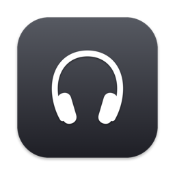
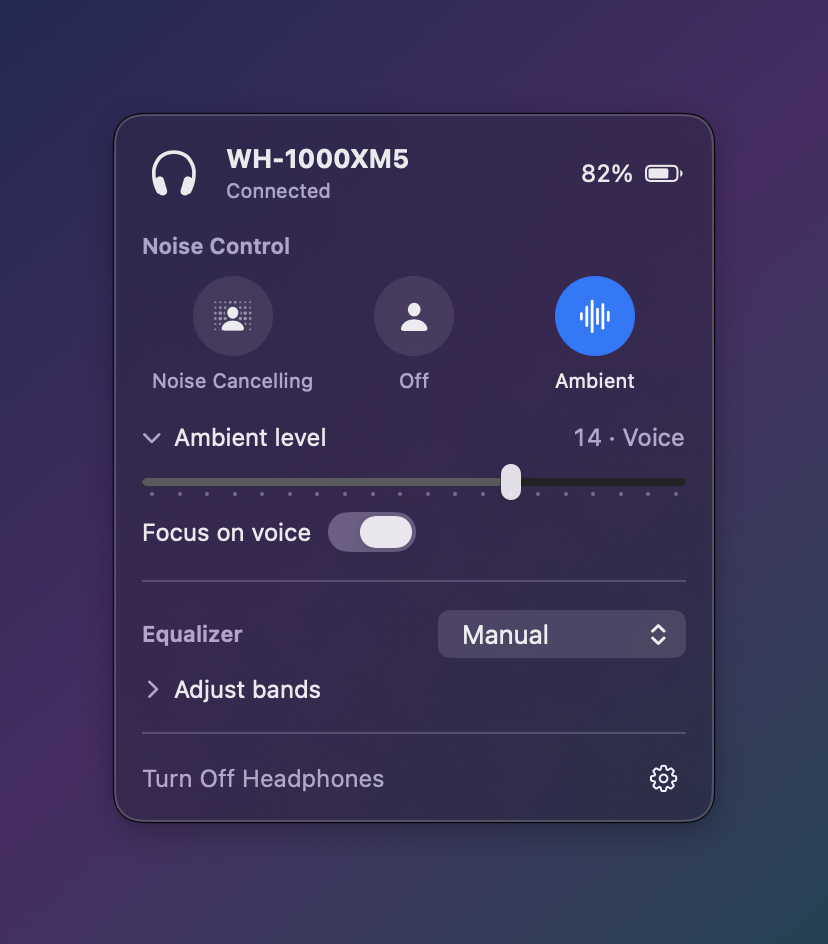
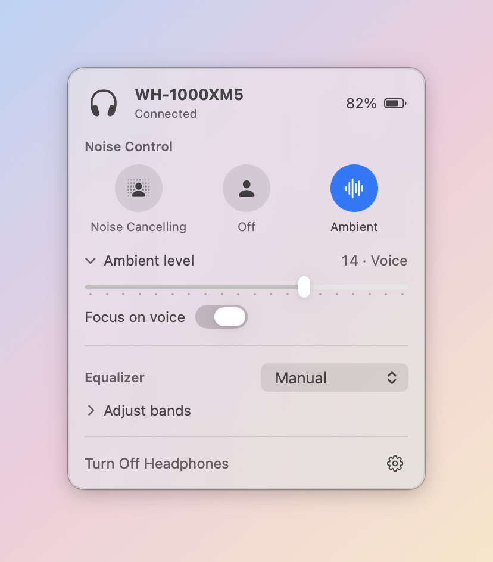
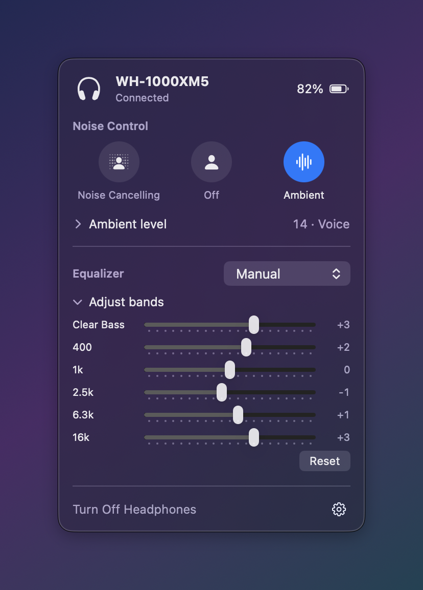
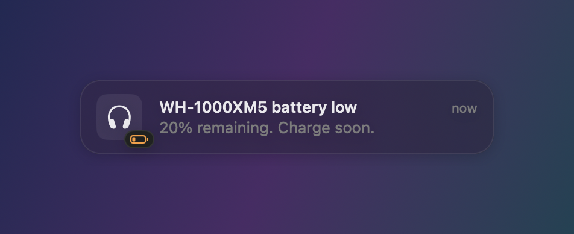

<p align="center">
  
</p>

<h1 align="center">SonyBar</h1>

<p align="center">
  AirPods-style menu bar controls for the <b>Sony WH-1000XM5</b> on macOS.<br>
  Switch noise cancelling and ambient sound, tune the EQ, and check battery without picking up your phone.
</p>

<p align="center">
  
  
</p>

## Features

- **Noise control**: Noise Cancelling, Off, or Ambient with one click, with a short confirmation sound (can be turned off in the ⚙︎ menu)
- **Ambient level**: 1–20 slider plus *Focus on voice*
- **Equalizer**: Sony's presets (Bright, Excited, Mellow, Relaxed, Vocal, Treble Boost, Bass Boost, Speech, Custom 1/2) and a Manual EQ with Clear Bass and five bands
- **Battery**: exact percentage in the panel
- **Volume slider** that sets the headphones' own volume, so it works for audio from your phone too (multipoint), and follows changes made on the headset
- **Low-battery warnings**: percentage appears next to the menu bar icon at 20% or below, with an alert at 20% and 10%
- **Stays in sync**: press the NC/Ambient button on the headphones and the menu updates instantly
- **Only there when you need it**: like AirPods, the menu bar icon appears when the headphones connect and disappears when they disconnect
- **Reconnects automatically** when your headphones connect to the Mac and after your Mac wakes from sleep. If the headphones don't answer, SonyBar keeps retrying in the background instead of spinning forever
- **Switches Mac audio to the headphones** when they connect, even when macOS stays on the speakers (common with multipoint). Can be turned off in the ⚙︎ menu
- **Turn off headphones** from the Mac, plus **Launch at Login**
- Native SwiftUI, no Dock icon, light and dark mode

<p align="center">
  
</p>

<p align="center">
  
</p>

## Requirements

- macOS 14 Sonoma or later
- Sony WH-1000XM5 paired with your Mac (tested on firmware 2.5.1)
- Xcode Command Line Tools to build (`xcode-select --install`). Full Xcode is not needed. If the newest SDK can't build SwiftUI with your tools (seen with the macOS 27 SDK), `build.sh` falls back to an older installed SDK automatically.

Other Sony headsets that use the same "v2" protocol (WH-1000XM6, WF-1000XM5, LinkBuds S, …) may work but are untested. Reports are welcome.

## Install

### Download

1. Download **SonyBar-x.y.z.zip** from the [latest release](https://github.com/Santosh611/SonyXm5-Menubar/releases/latest) and unzip it.
2. Drag **SonyBar.app** into **Applications**.
3. SonyBar isn't notarized by Apple (that needs a paid developer account), so macOS blocks it the first time. Either:
   - open it once, then go to **System Settings → Privacy & Security** and click **Open Anyway**, or
   - run `xattr -dr com.apple.quarantine /Applications/SonyBar.app` in Terminal.

### Build from source

Takes about a minute and avoids the Gatekeeper step:

```sh
git clone https://github.com/Santosh611/SonyXm5-Menubar.git
cd SonyXm5-Menubar
./build.sh --install
open /Applications/SonyBar.app
```

The headphones icon appears in your menu bar. On first launch macOS may ask for Bluetooth access. Allow it.
Enable **Launch at Login** from the ⚙︎ menu at the bottom of the panel.

> SonyBar only opens the headphones' control channel. Audio keeps going through macOS as usual.

## Troubleshooting

**The panel says "Headphones didn't respond. Retrying automatically."**
Bluetooth audio is fine, but the headphones aren't answering SonyBar's control channel. The XM5 lets only one device use that channel at a time, so this usually means the **Sony Sound Connect** app on your phone (or another computer) is holding it. SonyBar keeps retrying and connects by itself, within about 30 seconds, once the other device lets go. Closing the Sony app on the phone frees it straight away.

## How it works

The XM5 exposes a Bluetooth RFCOMM service (`956C7B26-D49A-4BA8-B03F-B17D393CB6E2`) that speaks Sony's "MDR" protocol, the same one the Sony Sound Connect app uses. SonyBar opens that channel with IOBluetooth and exchanges small framed packets:

```
> [type] [seq] [length:4] [payload…] [checksum] <     (0x3C/0x3D/0x3E escaped)
```

| Payload | Meaning |
|---|---|
| `68 17 01 <on> <nc=0/ambient=1> <voice> <level>` | Set noise control |
| `22 00` → `23 00 <level> <charging>` | Battery |
| `56 00` → `57 00 <preset> 06 <clearBass> <b1…b5>` | Equalizer (values offset by +10) |

The protocol was reverse-engineered by the [SonyHeadphonesClient](https://github.com/mos9527/SonyHeadphonesClient) project, which SonyBar used as a reference.

## Development

```sh
./build.sh                       # build/SonyBar.app
./build.sh --install             # also copy to /Applications
./build.sh --release             # universal build zipped into dist/ for GitHub releases
```

The binary has a few command-line modes for testing without the UI:

```sh
BIN=build/SonyBar.app/Contents/MacOS/SonyBar

$BIN --probe --debug                          # connect, dump packets, print headset state
$BIN --probe --mode nc|ambient|off            # change noise mode
$BIN --probe --level 12 --voice on            # ambient level / voice focus
$BIN --probe --eq "bass boost"                # EQ preset
$BIN --probe --bands 3,-2,0,4,-5,10           # Clear Bass + 5 bands (-10…10)
$BIN --list-audio                             # audio outputs (* = current)
$BIN --test-audio-switch                      # move output away and back to the headset
$BIN --test-battery-alerts                    # low-battery alert logic
$BIN --test-notification [--critical]         # show the alert banner
$BIN --screenshots docs/screenshots           # regenerate README screenshots (demo data)
swift tools/make-icon.swift                   # regenerate Resources/AppIcon.icns
```

Set `SONYBAR_DEBUG=1` to log every packet from the menu bar app.

| File | |
|---|---|
| `Sources/SonyBar/Protocol.swift` | Packet framing, commands, presets |
| `Sources/SonyBar/HeadphoneLink.swift` | RFCOMM channel, ACK queue, retries |
| `Sources/SonyBar/HeadphoneController.swift` | Device discovery, reconnects, state |
| `Sources/SonyBar/MenuView.swift` | Menu bar panel |
| `Sources/SonyBar/BatteryAlerts.swift`, `BannerWindow.swift` | Low-battery warnings |

### Notes

- Builds are ad-hoc signed. macOS doesn't allow notifications from ad-hoc signed apps, so battery alerts use SonyBar's own notification-style banner. A Developer ID–signed build would use real notifications automatically.
- Not yet supported: DSEE Extreme, Speak-to-Chat, Adaptive Sound Control, saving to Custom 1/2. PRs welcome.

## Disclaimer

SonyBar is an independent project and is not affiliated with, endorsed by, or sponsored by Sony. "Sony" and "WH-1000XM5" are trademarks of Sony Group Corporation. It uses an undocumented protocol, so use it at your own risk.

## License

[MIT](LICENSE)
